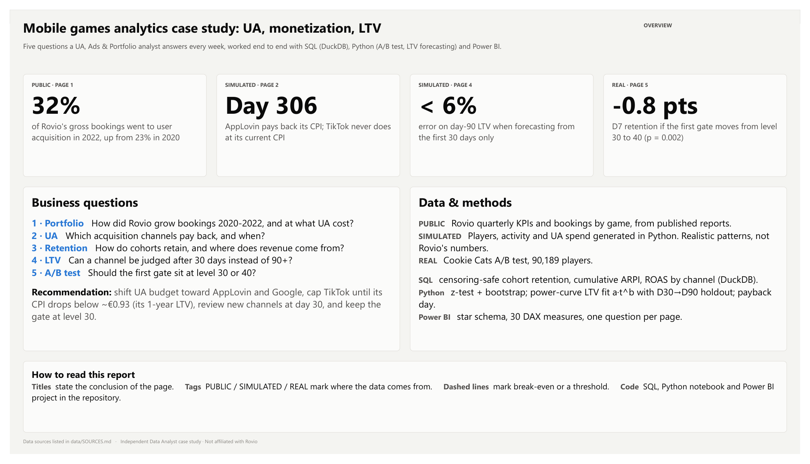
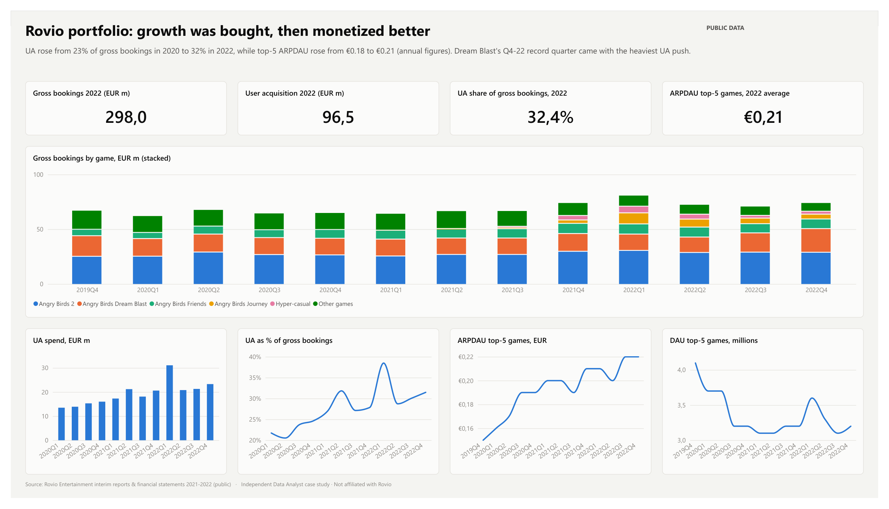
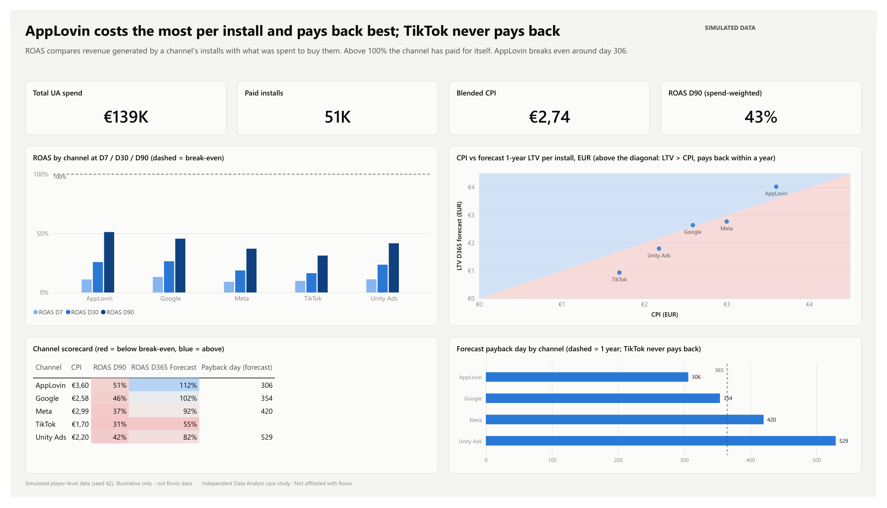
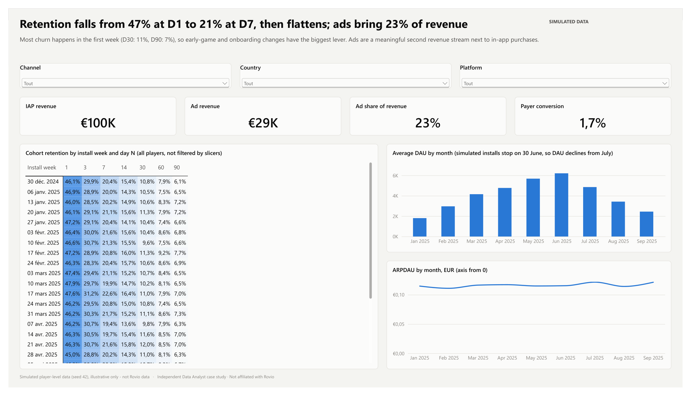
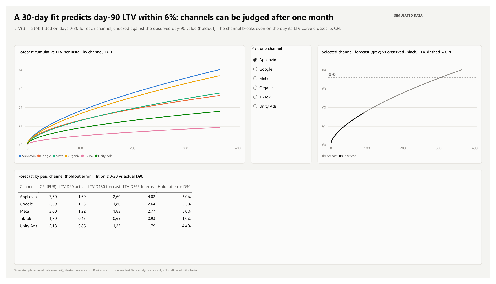
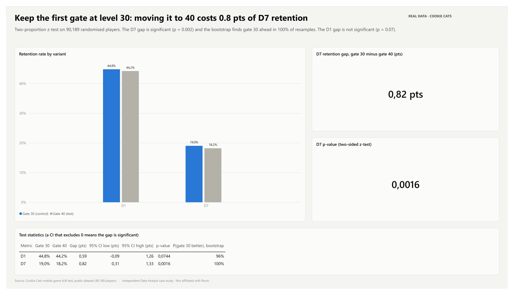

# Mobile game UA & monetization - a case study for Rovio

Independent analysis built for a *Data Analyst - UA, Ads, Portfolio & Finance* application.
Not affiliated with Rovio. Rovio figures come from its public reports; player-level data is either public (Cookie Cats) or **simulated and labelled as such**.

## Questions and answers
| # | Question | Data | Answer |
|---|---|---|---|
| 1 | How did Rovio's portfolio and UA intensity evolve 2020-2022? | Rovio interim reports (real) | UA went from 23% (2020) to 32% (2022) of games' gross bookings; top-5 ARPDAU rose from €0.18 to €0.21 (annual averages). Dream Blast's Q4-22 record quarter came with the heaviest UA push. |
| 2 | Does moving the first gate from level 30 to 40 hurt retention? | Cookie Cats A/B test, 90,189 players (real) | Yes: D7 retention 19.0% vs 18.2% (-0.8 pts, p = 0.002, bootstrap 100% in favour of gate 30). Keep the gate at level 30. |
| 3 | Which UA channels pay back, and when? | Simulated casual-game cohorts (72k installs) | AppLovin has the highest CPI and pays back first (~day 306). TikTok is cheapest but never pays back at current CPI. |
| 4 | Can we judge a channel after 30 days instead of 90? | Same | Yes: a power-curve LTV fitted on days 0-30 predicts day 90 within 6% for every channel. |

## The report
Six pages, one question each: overview, Rovio portfolio, UA performance, retention & monetization, LTV forecast, A/B test.
Full report: [docs/RovioCaseStudy.pdf](docs/RovioCaseStudy.pdf).



| | |
|---|---|
|  |  |
|  |  |
|  | |

## How it is built
```
data/raw        Rovio PDFs + Cookie Cats CSV (public)
data/clean      cleaned Rovio KPIs + simulated players / activity / UA spend
sql/            DuckDB queries: cohort retention, cumulative ARPI by channel, ROAS by channel
notebooks/      analysis.ipynb: A/B test (z-test + bootstrap), LTV forecast, payback
powerbi/        Power BI project (.pbip: semantic model in TMDL + report), .pbix, theme
docs/           report PDF and screenshots
```
- **SQL** handles right-censoring: a cohort only counts day N once every player in it could have reached day N.
- **Python** fits `LTV(d) = a·(d+1)^b` per channel, validates it on a day-30 → day-90 hold-out, then forecasts D180/D365 and payback.
- **Power BI**: star schema (Activity, Players, UA Spend + Date, Channel, Country), inactive install-date relationship used through `USERELATIONSHIP`, 30 measures in display folders.

## Reproduce
```bash
python -m venv .venv && .venv/bin/pip install -r requirements.txt
.venv/bin/python src/generate_sim.py      # simulated data (seed 42)
.venv/bin/python src/run_sql.py           # SQL outputs -> data/output
.venv/bin/jupyter nbconvert --to notebook --execute --inplace notebooks/analysis.ipynb
```
Power BI: open `powerbi/RovioCaseStudy.pbip` (set the `DataFolder` parameter to your `data\` folder) and refresh.
The report pages are generated by `src/build_report_pages.py`.

## Limits
- Simulated data demonstrates methods, not Rovio's real channel performance.
- Rovio's KPIs include Ruby Games from Q3-2021; trends use the top-5 games figures.
- UA share here divides by gross bookings; Rovio reports it against games' revenue.
